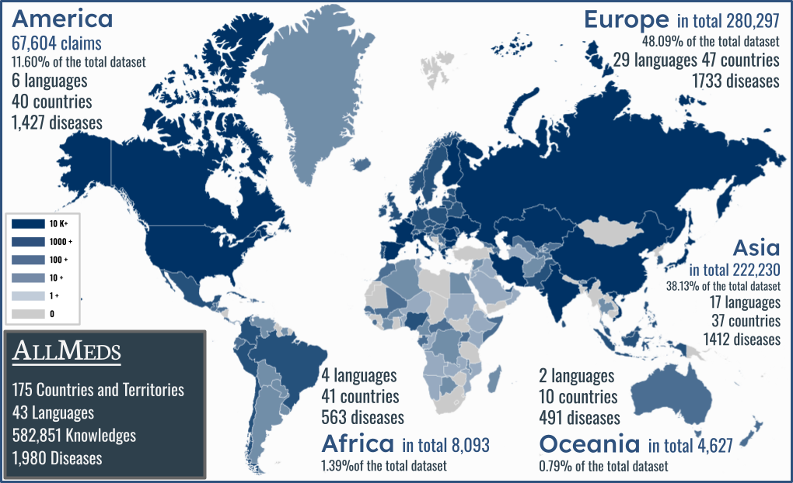

# AllMeds
Benchmarking Disease-Remedy Knowledge Across 43 Languages and 175 Countries

> GitHub Pages is not available for this repository at the moment (kept private for anonymity). To explore the interactive version of the map, please [download the HTML file](data_distribution/Interactive_Map.html) and open it locally in your browser.
